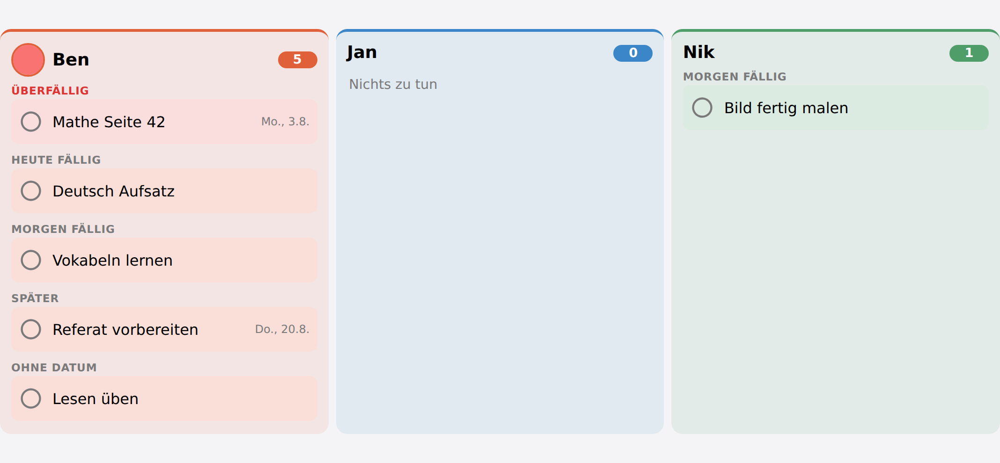

# Homework

Each child gets a Home Assistant **todo list**:

```
todo.hausaufgaben_ben
```

A `todo` list rather than something of Schoolday's own, because Home Assistant already
has a shape for "things still to do" — and it arrives with a voice interface, a card, a
calendar view and an API that Schoolday would only have reinvented worse. **Anything that
can talk to a todo list can put homework on it**: Assist, the built-in todo card, a
phone, an automation.

What Schoolday adds is whose list it is, and the sorting a school evening actually wants:
unfinished first, soonest first, undated last within its group — a thing with a deadline
is what has to be looked at, and an empty date is not an early one.

## The card

*Grouped by when it is due. The number beside each name is what is left.*


`schoolday-homework-card` is the reading end. It groups by **when the work is due**:

- Overdue
- Due today
- Due tomorrow
- Later
- No date

A flat list sorted by date answers the same question in principle, but at seven in the
morning reading dates is work and "today" is not. Inside "today" and "tomorrow" the date
beside each line is dropped again, because the heading already said it; overdue keeps it,
because *how* late matters.

Tapping a line ticks it off through `todo.update_item`, so the change is visible
everywhere, not just on this card.

## From the school's own system

Where the school writes homework into a system that reaches Home Assistant as a to-do
list — [Schulmanager Online](exceptions.md#with-schulmanager-online) does — set that list
as the child's **Homework list** under **Edit a family member**. Schoolday copies new
homework from it onto the child's own list, so there is one list to work through, whoever
wrote the homework down.

- **Linking it copies nothing.** The first time the list is read, Schoolday only notes
  what is already on it. Schulmanager never ticks anything off, so its list holds every
  piece of homework since the start of the school year, and linking it must not hand a
  child thirty of them at once. Only what arrives after that is copied.
- **It is ticked off here.** Ticking it off on the school system's list as well ticks it
  here once; reopening it here is not undone again.
- **Deleted here stays deleted.** Schoolday remembers what it copied, so taking a piece of
  homework off the list does not bring it back the next time the school's list is read.
- A date the school system writes in front of the text — Schulmanager writes
  `[2026-10-12] Deutsch: AB`, the day it was set — is taken off. It is not when the work
  is due; set that yourself if it matters.

The school's list is read whenever it changes, and every half hour besides.

## Finished work

Kept for a **fortnight**, then swept. Not for the child's benefit — so that *"did you do
the maths?"* on Thursday still has an answer on Friday.

Finished work is out of the way by default; `show_done: true` on the card brings it back.
