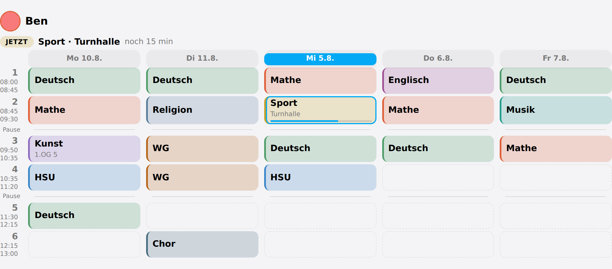
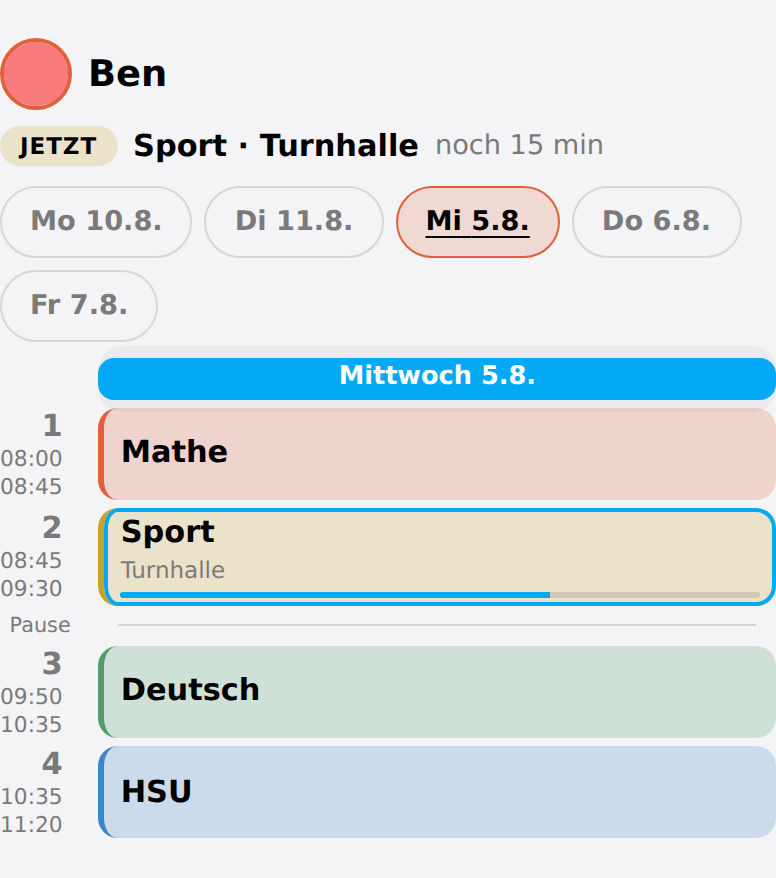
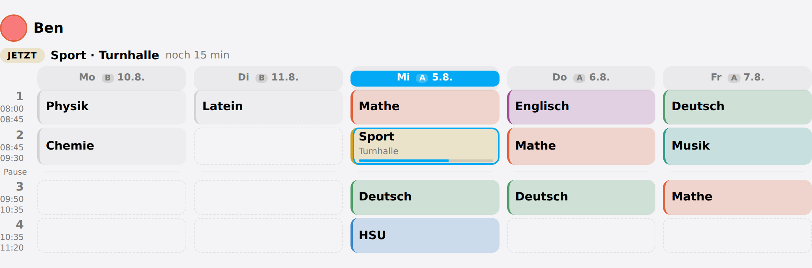
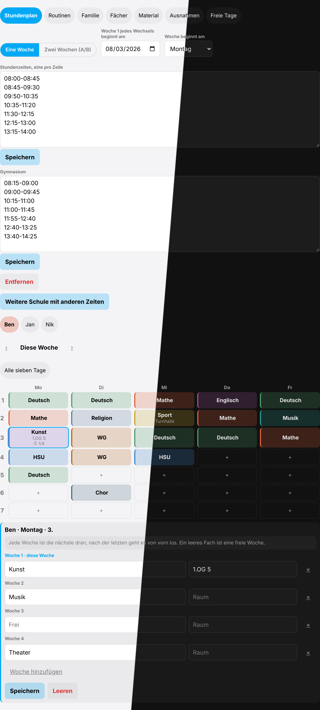
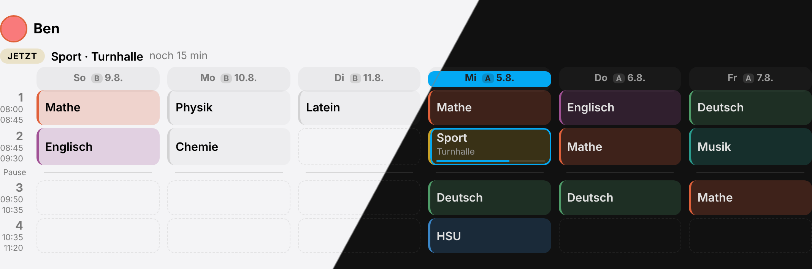

# Timetable

A timetable is fixed for a school year, which is why Schoolday stores it rather than
reading it from a calendar. Everything is typed in once and every card and every
automation reads it from there.



*A week: today highlighted, the running lesson outlined, free periods drawn rather than left out*

## Lesson times

One `HH:MM-HH:MM` per line, in order:

```
08:00-08:45
08:45-09:30
09:50-10:35
10:35-11:20
```

**Breaks come from the gaps.** Anything from five minutes upwards between two periods is
a break and is drawn as one — which is exactly the five-, ten- and sixty-minute gaps a
school day already has. There is nothing to configure.

These are the times a child gets when nothing else is said, which for most households is
everybody. A child whose day starts later at the *same* school simply has no lesson in the
first period.

## Two schools that do not ring together

A sibling at another school is a different matter: their first period may start at 08:15
and their morning break may be half an hour. Nothing in the grid above can say that, and
guessing it wrong is not cosmetic — it is the running-lesson line, the sensor state, and
the `schoolday_lesson_started` event all landing a quarter of an hour early.

So a second school gets its **own named times**, under **Configure → Another school's
lesson times** or in the timetable section of the [admin card](cards.md#admin-card):

```
Gymnasium
  08:15-09:00
  09:00-09:45
  10:15-11:00
```

Then put the children who go there on it, in their own form under **Edit a family
member**. Everybody else stays on the household's times without being asked.

Named after the school rather than kept per child, and that is the point: two siblings at
the same school share one entry, so a bell time that moves is typed once instead of twice.
It is the same reason [materials](routines.md#what-each-subject-needs) are held per subject
rather than per child.

From there everything follows the child. Their card draws their rows, their breaks come
out of *their* gaps, their sensor wakes at their boundaries, and their events fire when
their lessons actually start.

**Remove** takes a school away again, and asks first — naming the children it moves, because
"remove Gymnasium?" and "remove Gymnasium, and move Nik?" are different questions. They fall
back to the household's times rather than to none: a school deleted out from under a child
leaves them with a working timetable, which is the better of the two wrong answers.

In the options dialog, where there is no button to press, clearing that school's times
does the same thing.

## One week per child

Tap a cell and type the subject. A room can go with it. The grid shows the first five days
of the week and any other day that already has a lesson. **All seven days** shows the rest, so you
can add the first lesson on a Friday or a Saturday.

In the options dialog the same week is a text field, one line per period:

```
Deutsch
Mathe
Kunst | 1.OG 5
-
Deutsch
```

- `-` leaves a period free
- `Fach | Raum` or `Fach @ Raum` puts the room next to the subject
- `5. Sport` names its period outright, so a day that starts at the third period does
  not need two placeholder lines first
- `Kunst / Musik | R2 / -` is a period that [takes turns](#lessons-that-take-turns): a
  slash with a space on each side between the weeks. `Deutsch/Englisch`, without the
  spaces, stays one subject

{: .warning }
> **Subject names are exact strings** everywhere downstream: the sensor state, the colour,
> and whatever an automation compares against. `Sport` on Monday and `sport` on Wednesday
> would be two subjects with two colours — so when a week is saved, the first spelling in
> it wins for the whole week. Across two children it deliberately does not, because that
> would silently undo a rename.

## Colours

Every subject already has a colour, derived from its name by a stable hash. Maths is the
same colour on every child's card and stays that colour when the week is rewritten. The
colour editor is only ever a **correction**, which is why it offers the current colour
rather than an empty field.



*Too narrow for a week: the card falls back to one day and offers the others as chips*

## Two-week timetables

Some schools alternate an **A week** and a **B week**. Switch the cycle to two weeks and
say which **calendar week** week A starts in — the way a school says it. The editor then
has an A/B switch above the grid, and the display card marks every column with the week
it belongs to.



*A two-week timetable: every column says which week it belongs to, and Monday points at next week — which is a B week*

What gets **stored** is the Monday of that week, not the week number. An ISO year
has 52 or 53 weeks — 2026 has 53 — so "A is the odd weeks" would swap itself over some
new years and not others, and you would find out in February. A Monday keeps meaning the
same thing.

Turning the cycle back off does not throw week B away. It stops showing it.

```yaml
action: schoolday.set_cycle
data:
  weeks: 2
  iso_week: 37
```

## Lessons that take turns

Some schools do not stop at A and B. Art, music, drama and biology share one period and
take it in turn, a week each. A lab session comes round every third week. Typing four
whole weeks to say that would be four copies of everything that does not change.

So a single period can **take turns** instead. Open the cell in the
[admin card](cards.md#admin-card), press **Takes turns with another week**, and type a
subject for each week. **Add a week** adds one more, up to eight. Leave a week's subject
empty for a free period. After the last week the first one comes round again.


*A period that takes turns, open in the editor: one row per week, this week's marked. In
the grid the cell shows only this week's turn, with ↻ 1/4 beside it.*

The grid shows one week at a time, as the board does. Each rotating cell shows its
turn for that week and which turn of how many it is. Once a period takes turns,
**‹ This week ›** above the grid steps through the weeks, so you can check next week's
turn before Monday. The editor of an open cell lists all the turns, because that is
where you change them.

Every period has its own length, and they can sit side by side:

| What the school says | What to type |
|---|---|
| Art, music, drama and biology take turns (A/B/C/D) | `Kunst / Musik / Theater / Bio` |
| Lab every third week, a free period otherwise | `Labor / - / -` |
| Choir every other week, orchestra in between | `Chor / Orchester` |

Every other period stays as it was, the same every week. A household that never uses
this does not see it.

**Week 1 is the same week for everything.** Every rotation counts from the week that is
week A of a [two-week timetable](#two-week-timetables), so the first turn of every
period is always in the same week. Without a two-week timetable, **Week 1 of every
rotation begins** appears at the top of the timetable section as soon as a period takes
turns. Pick any day in that week. If nothing set it yet, saving the first rotation makes
this week week 1, so the turn you typed first is the one the board shows now.

A two-week timetable and rotations work together. A cell in week A only runs every
other week, so its turns count **A weeks**: `Chor / Orchester` in week A is choir in one
A week and orchestra in the next A week, with the B week in between. A cell in week B
counts B weeks the same way.

The sensor and the cards always show the turn of the week a column stands for. The
running lesson, today's and tomorrow's subjects, the evening packing list and the
`schoolday_lesson_started` event all follow it.

{: .warning }
> **Everything counts from week 1, so moving it moves every rotation.** Changing week 1,
> or the week A of a two-week timetable, shifts every period that takes turns. So does
> switching the two-week timetable on or off, because a rotation in an A/B timetable
> counts A weeks or B weeks rather than every week. After either change, step through a
> few weeks above the grid and check that the turns are where the school has them.

```yaml
action: schoolday.set_lesson
data:
  member: Ben
  weekday: 0
  period: 3
  rotation: ["Kunst", {"subject": "Musik", "room": "R2"}, "-", "Bio"]
```

## When the week begins

Not every school week starts on Monday. In Israel it starts on Sunday.

**Week begins on** sets the first day of the week for the whole household. It is in the
options dialog under **First day of the week**, and in the admin card's **Timetable**
tab, next to the cycle. The default is Monday. It sets four things:

- The cards start the week on that day.
- The cards always show the first five days of the week, so Monday to Friday or Sunday
  to Thursday. Any other day appears as soon as it has lessons, so a school week of six
  days, such as Sunday to Friday, shows all six.
- In a [two-week timetable](#two-week-timetables), a new week of the cycle starts on that
  day. When the week begins on Sunday, Sunday gets the same letter as the Monday after it.
- The sensor's `outlook` starts on that day. This affects which days the card shows when
  [past days are not rolled on](#which-day-a-column-means).

Home Assistant has its own *first day of the week* in each user's profile. Schoolday does
not use it. It is a personal setting that follows each user's language, so two people in
one home can have different days, and a timetable has to mean the same week for everybody.


*A two-week timetable in a week that begins on Sunday. Sunday is the first column. The
coming Sunday is already part of next week, a B week, so it shows week B's lessons.*

Changing it does not move week A: Monday to Saturday keep their letters, and only Sunday
changes.

```yaml
action: schoolday.set_cycle
data:
  weeks: 2
  week_start: sunday
```

## Which day a column means

A timetable repeats forever, so on its own a column can only say what a Tuesday is
usually like. Schoolday's columns point at **dates**: each one carries the date it
stands for, and by default a weekday that has already been rolls on to next week's — so
on Wednesday, the Monday column is next Monday.

Turn that off with `roll_days: false` on the card to see the week as it stands, past days
included.

Because a column is a date, everything dated follows from it without any extra option:
holidays, holiday care, a child at home ill, a cancelled period, which week of an A/B
cycle you are looking at, and which turn a [rotating period](#lessons-that-take-turns)
is on.
